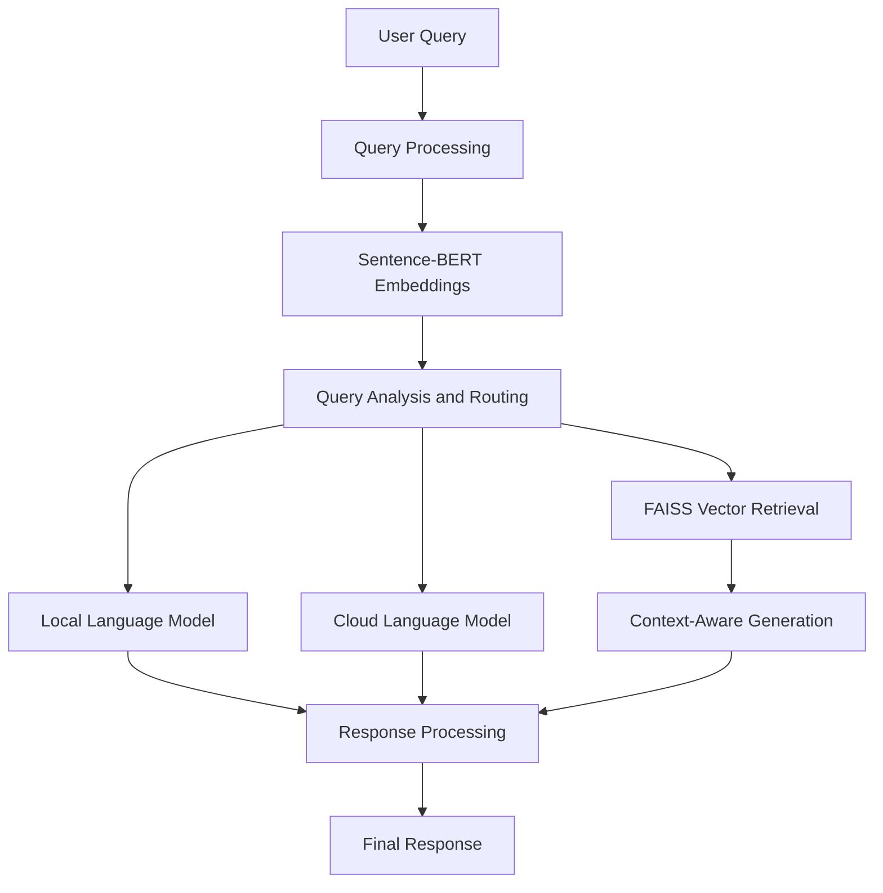

# 🕳️ Blackhole AI — Intelligent Query Routing & Cost-Optimized RAG

<p align="center">
  <strong>An intelligent AI system that routes queries to suitable language models for efficient, context-aware, and cost-conscious responses.</strong>
</p>

<p align="center">
  🚀 <a href="https://blackhole-ai.onrender.com/">Live Demo</a>
</p>

---

## 📌 Overview

**Blackhole AI** is an AI-powered application designed to make Large Language Model (LLM) interactions more efficient through intelligent query routing and Retrieval-Augmented Generation (RAG).

Instead of relying on a single model for every query, the system is designed to evaluate query characteristics and select an appropriate processing approach. By combining semantic embeddings, vector-based retrieval, and hybrid local/cloud model routing, Blackhole AI explores how AI applications can balance response quality, computational efficiency, and operational cost.

The project demonstrates the practical application of Natural Language Processing (NLP), vector search, LLM integration, and intelligent decision-making in modern AI systems.

## ✨ Key Features

- **Intelligent Query Routing:** Selects an appropriate processing path based on query characteristics and complexity.
- **Retrieval-Augmented Generation (RAG):** Combines relevant retrieved context with language-model generation to support context-aware responses.
- **Semantic Search:** Uses sentence embeddings to represent the meaning of queries and documents.
- **Vector Retrieval:** Uses FAISS for efficient similarity-based retrieval from indexed content.
- **Hybrid LLM Architecture:** Explores routing between local and cloud-based language models.
- **Cost-Aware Processing:** Aims to reduce unnecessary use of more resource-intensive models.
- **Web-Based Access:** Provides a deployed interface for trying the application.

*Note: Features listed describe the project's intended architecture. Availability of individual features depends on the current implementation and deployment configuration.*

## 🧠 How It Works

1. **User Input:** The user submits a query through the application.
2. **Query Analysis:** The system evaluates the query and represents its semantic characteristics.
3. **Context Retrieval:** Relevant information can be retrieved using embedding-based similarity search and FAISS.
4. **Intelligent Routing:** The routing mechanism determines a suitable model or processing path.
5. **Response Generation:** The selected language model generates a response using the query and, where applicable, retrieved context.
6. **Response Delivery:** The generated answer is returned to the user.

## 🏗️ System Architecture



The diagram illustrates the conceptual architecture. The actual execution path depends on the routing logic and configuration implemented in the repository.

## 🛠️ Technology Stack

| Technology | Purpose |
|---|---|
| Python | Core AI and application logic |
| Sentence-BERT | Semantic embeddings |
| FAISS | Vector similarity search |
| Retrieval-Augmented Generation | Context-grounded response generation |
| Large Language Models | Natural language understanding and generation |
| Local and Cloud LLMs | Hybrid model-processing approach |
| Render | Web application deployment |

*Update this list to match the exact libraries, frameworks, and model providers used in your source code.*

## 🎯 Problem Statement

Traditional LLM applications often use the same model for every request, regardless of query complexity. This can lead to unnecessary computational overhead, higher API costs, and inefficient resource utilization.

Blackhole AI explores an alternative approach: analyze incoming queries, retrieve relevant information when needed, and route requests through a suitable processing strategy.

### Project Objectives

- Improve the efficiency of LLM-based applications.
- Explore adaptive query routing using semantic information.
- Integrate vector retrieval into an AI response-generation pipeline.
- Investigate the trade-offs between local and cloud-based inference.
- Balance response quality, latency, and computational cost.

## 💡 Potential Applications

- Intelligent question-answering systems
- Context-aware AI assistants
- Document search and retrieval
- Cost-conscious LLM applications
- Enterprise knowledge retrieval
- Hybrid AI inference systems

## 🚀 Live Demo

Try the deployed application:

**[Launch Blackhole AI](https://blackhole-ai.onrender.com/)**

The availability and response time of the demo may depend on the hosting environment and configured AI services.

## 💻 Run Locally

To run the project locally, clone your repository and install the dependencies specified by your project.

### 1. Clone the repository

```bash
git clone <YOUR_GITHUB_REPOSITORY_URL>
cd <YOUR_REPOSITORY_FOLDER>
```

### 2. Create a virtual environment

```bash
python -m venv venv
```

Activate it on Windows:

```bash
venv\Scripts\activate
```

On macOS or Linux:

```bash
source venv/bin/activate
```

### 3. Install dependencies

If your repository contains a `requirements.txt` file:

```bash
pip install -r requirements.txt
```

### 4. Configure environment variables

Create a `.env` file if required by your implementation. Add the API keys and model settings used by your application.

```env
# Example placeholders — use the variables required by your code
LLM_API_KEY=your_api_key_here
```

Never commit real API keys, passwords, or other secrets to GitHub.

### 5. Start the application

Use the startup command specified by your framework and project configuration. For example, if the application uses Flask:

```bash
python app.py
```

If it uses FastAPI, Streamlit, or another framework, replace this command with the appropriate one.

## 📁 Project Structure

The following is an illustrative structure. Adjust it to reflect your actual repository.

```text
Blackhole-AI/
├── app.py
├── requirements.txt
├── .env.example
├── README.md
├── models/
├── retrieval/
├── routing/
└── utils/
```

## 🔬 Research and Learning Outcomes

This project explores several important areas of applied AI engineering:

- Semantic representation using sentence embeddings
- Vector indexing and similarity-based retrieval
- Retrieval-Augmented Generation pipelines
- Routing strategies for language models
- Trade-offs between model quality, inference cost, and latency
- Deployment of AI-powered web applications

It also provides a foundation for evaluating routing strategies using measurable criteria such as response quality, latency, token usage, and estimated inference cost.

## 🔮 Future Enhancements

- Implement a more robust query-complexity scoring mechanism.
- Benchmark local and cloud models on a common evaluation dataset.
- Add routing analytics and request-level cost tracking.
- Improve retrieval quality through hybrid keyword and semantic search.
- Add automated tests for retrieval, routing, and response generation.
- Introduce configurable routing thresholds and fallback strategies.
- Evaluate the system on latency, accuracy, and cost metrics.

## 👨‍💻 Author

**Sahil Katkar**

BE in Information Technology | AI & Software Development

Interested in Artificial Intelligence, Python, NLP, Retrieval-Augmented Generation, and intelligent software systems.

## ⭐ Support

If you find this project interesting, consider starring the repository and sharing feedback or suggestions.

---

*Blackhole AI — Smarter routing. Relevant context. More efficient AI.*

